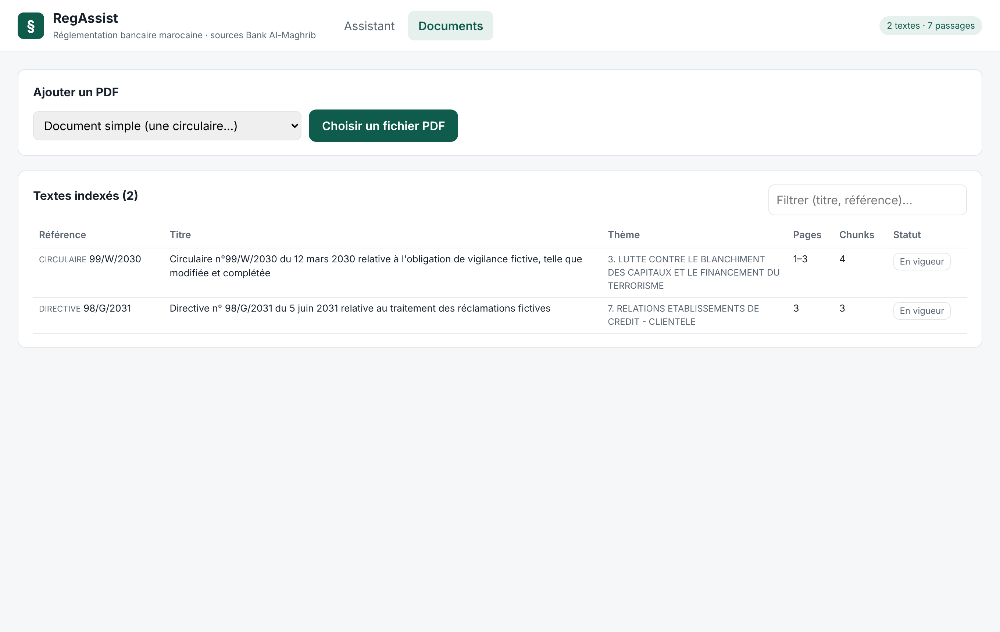

# 10 — L'API FastAPI et l'interface React

Fichiers : `backend/app/api/`, `backend/app/services/chat.py`, `frontend/src/`

## 1. Les endpoints

La documentation interactive Swagger, générée depuis les schémas Pydantic, est sur <http://localhost:8000/docs>.

| Méthode | Route | Rôle |
|---|---|---|
| `POST` | `/api/documents` | envoyer un PDF (`file`, `profile`) et lancer l'ingestion → **202** avec la tâche |
| `GET` | `/api/jobs`, `/api/jobs/{id}` | suivi des ingestions |
| `GET` | `/api/documents?q=&theme=&status=` | textes indexés (avec le nombre de chunks) |
| `PATCH` | `/api/documents/{id}` | `{"status": "abroge"}` pour exclure un texte des recherches |
| `GET` | `/api/themes` | les parties du recueil (pour le filtre) |
| `GET` | `/api/chunks/{id}` | le passage exact cité |
| `POST` | `/api/chat` | question → **flux SSE** |
| `POST` | `/api/chat/sync` | question → réponse JSON complète (curl, scripts) |
| `GET` | `/api/conversations/{id}` | historique |
| `GET` | `/api/health` | état de la base, de Redis, fournisseurs, compteurs |

### Exemples

```bash
curl -F "file=@circulaire.pdf" -F "profile=generic" localhost:8000/api/documents
curl -s localhost:8000/api/jobs/<id>
curl -s -X POST localhost:8000/api/chat/sync -H 'content-type: application/json' \
     -d '{"question": "Que prévoit la 5/W/2017 sur le bénéficiaire effectif ?"}'
```

### Le format du flux `/api/chat` (Server-Sent Events)

```
event: start
data: {"conversation_id": "…"}

event: step
data: {"node": "retrieve", "label": "Recherche dans les textes", "detail": "retrieve:6"}

event: answer
data: {"answer": "…[1]…", "sources": [{"number": 1, "label": "Circulaire 5/W/2017, article 2, p. 631", "chunk_id": "…"}]}
```

Un événement `error` est envoyé en cas de problème : l'interface l'affiche à la place de la réponse.

## 2. L'organisation du code backend

```
routes (HTTP : validation, codes de statut)
   └─▶ services/chat.py (logique : conversation, agent, historique)
          └─▶ agent/graph.py  ─▶ retrieval/hybrid.py  ─▶ db
```

- Les **routes** ne contiennent pas de logique métier. Le service est injecté (`Depends(get_chat_service)`), ce qui permet aux tests de le remplacer par un service avec un faux LLM (`app.dependency_overrides`).
- Une **session SQLAlchemy par requête** (`get_db`), fermée automatiquement.
- **La validation des envois :** l'en-tête `%PDF-` est vérifié (415 sinon) ainsi que la taille maximale (`MAX_UPLOAD_MB`, 413). Les fichiers sont renommés par leur SHA-256.
- **Les erreurs :** un gestionnaire global renvoie 500 avec un message neutre et journalise la trace complète.
- **L'historique :** les 8 derniers messages de la conversation sont transmis à l'agent, ce qui permet les questions de suivi (« et pour les personnes morales ? »).

## 3. L'interface React

| Composant | Rôle |
|---|---|
| `App.tsx` | barre du haut (onglets, état de l'API, nombre de textes et passages) |
| `Chat.tsx` | fil de discussion, étapes en direct, réponse, sources, filtre par thème, nouvelle conversation |
| `AnswerText.tsx` | rendu Markdown minimal (gras, listes) avec des **citations [n] cliquables**, sans injecter de HTML (pas de risque XSS) |
| `SourcePanel.tsx` | panneau latéral : le passage exact, sa section, le texte d'origine |
| `Documents.tsx` | envoi de PDF (choix du profil), suivi des tâches (actualisé toutes les 2 s pendant une ingestion), liste des textes, bascule en vigueur / abrogé |
| `api.ts` | client typé et **lecteur du flux SSE** |

**Pourquoi lire le flux avec `fetch` plutôt qu'avec `EventSource` ?** `EventSource` ne gère que les requêtes GET, alors que la question est envoyée en POST (le corps JSON contient les filtres). On lit donc le flux manuellement, avec `ReadableStream` et `TextDecoder`, en découpant sur les lignes vides.

**En développement**, Vite redirige `/api` vers `localhost:8000` (`vite.config.ts`). **En production**, nginx sert les fichiers construits et redirige `/api` vers le conteneur `api` avec `proxy_buffering off`, indispensable pour que le SSE arrive en direct et non d'un bloc à la fin.


